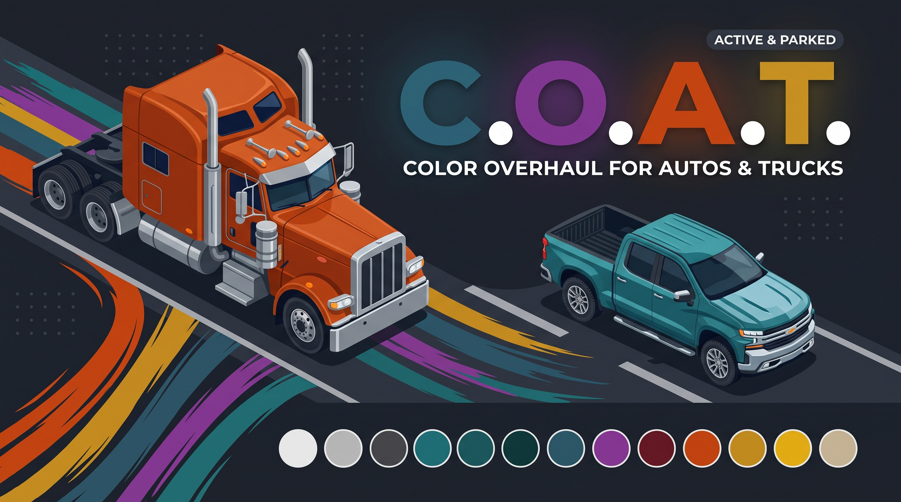

Color Overhaul for Autos and Trucks
C.O.A.T

## 📊 Official Release Information
* **Current Version:** 26.11.161 Stable
* **ATS Compatibility:** v1.61.* branch (Maybe older I do not know I developed on 1.61)
* **Development Environment:** Ubuntu 26.04.1 LTS
* Extracted by terminal by sk-zk Extractor tool
  * https://github.com/sk-zk/Extractor
* Official SCS Uploader tool running under Proton 
* **Architecture:** Pure definition-only (.sii) layout

---

## 📖 A Note from the Developer
This project is dedicated to the glory of God. Every mile driven and every line of code written is an expression of gratitude for the journey. May this mod bring a little more order, peace, and grace to the virtual highways we all travel. 
*— Built by a driver, for drivers.*

**Full Release Log & Source:** [GitHub](https://github.com/insanity35/COAT)
* **Our other mods:**
*	SGSB(Smart Gates, Dynamic Parking Lots & Safety Buffers)
  https://steamcommunity.com/sharedfiles/filedetails/?id=3820362300

---

# C.O.A.T. (Color Overhaul for Autos & Trucks)

**Tired of the highway looking like a bag of Skittles?**
Vanilla American Truck Simulator traffic tends to spawn with arcade-like, hyper-saturated colors that pull you right out of the simulation. Using data from 2015-2027 **C.O.A.T.** is a comprehensive visual realism mod that overhauls the color palettes and spawn ratios for both active AI traffic and static parked vehicles across the entire game. 

Branched directly from the realism-focused **SGSB (Smart Gates, Dynamic Parking Lots, and Safety Buffers)** project, C.O.A.T. partners great and applies a much-needed fresh coat of paint to the ATS world.

### 🚗 ACTIVE AUTO TRAFFIC (model/textures, def/car_color.sii)

* **Realistic Spawn Ratios:** Highways are now accurately flooded with high-volume fleet colors (Fleet White, Standard Silver, Modern Magnetic Gray, and Charcoal).
* **38 Custom RGB Definitions:** Translated a massive custom floating-point color array into the game engine, broken into distinct demographics (Commuter & Economy, Executive & Luxury, Truck & Utility).
* **Ultra-Rare Classics:** Neon colors have been drastically reduced. Instead, keep an eye out for ultra-rare vintage spawns like *2010 Jeep Mango Tango Pearl*, *1970 Dodge Plum Crazy Purple*, *1988 Ford Mustang Cabernet Red*, and *70s Vintage Mustard Gold*.

### 🚛 SEMI-TRUCKS & HEAVY FLEETS (def/vehicle/ai/)

Semi-trucks no longer pull from a generic pool. Dozens of new custom RGB definitions have been injected directly into specific AI truck brands to match their real-world counterparts:

* **Authentic Fleet Tones:** High-volume corporate fleet colors, construction ambers, and heavy-haul metallics tailored specifically to Freightliner, Kenworth, Mack, Peterbilt, Volvo, and Western Star AI models.
* **Heritage & Owner-Operator Customs:** Spot ultra-rare, brand-specific factory paints like *Mack’s Classic Bulldog Bronze*, *Kenworth’s Vintage Hawaiian Blue*, *Volvo’s 1954 Titan Heritage Orange*, and *Peterbilt’s Legendary Special Editions*.

### 🅿️ PARKED & STATIC VEHICLES

The immersion doesn't stop on the interstate. C.O.A.T. overhauls how the background world handles vehicles so that rest stops, residential areas, and industrial lots perfectly match the visual realism of the active AI traffic.

* **World Textures (`model/textures/`):** Custom-painted `.dds` grids replace the vanilla static color maps, mapping the new 38-color array directly to the background world geometry.

### 🛠️ COMPATIBILITY & LOAD ORDER

* Fully compatible with global AI density and traffic behavior mods.
* **Load Order:** Place C.O.A.T. **ABOVE** other traffic or AI density mods in your mod manager so the custom color definitions, models, and spawn ratios can overwrite the vanilla/modded defaults.

### 🗺️ ROADMAP

* **Model-Specific Auto Palettes:** Just like the brand-specific treatment applied to the semi-trucks, future updates will go vehicle-by-vehicle to restrict specific color selections *only* to the AI car models that would have actually offered them from the factory in real life.

---

## 🏆 Credits & Technical Acknowledgments
* **Development Group:** Smoke Show Studios, Smoke Show Creations & Harambes Children
* **Lead Developer & Tester:** meanshadows35
* **Technical Consultant:** Overdrive
* **Try out other mod SGSB faster gate openings at yards and more realistic parking lots!
	https://steamcommunity.com/sharedfiles/filedetails/?id=3764824734

A massive shout-out to our three-person team for pulling this together, and special thanks to the entire trucking community for the incredible passion and feedback.
* Developed natively on Ubuntu 26.04.1 LTS
* **Soli Deo Gloria**

---

## 📜 Complete Mod Release History

v26.10.161-(Oct14-1443)Published oct15
* Few color bugs that popped up
* dds compression and mipmapping enhancements 

v26.10.161(Oct12-1800)BETA
-Initial release mod. Description is release notes!!
